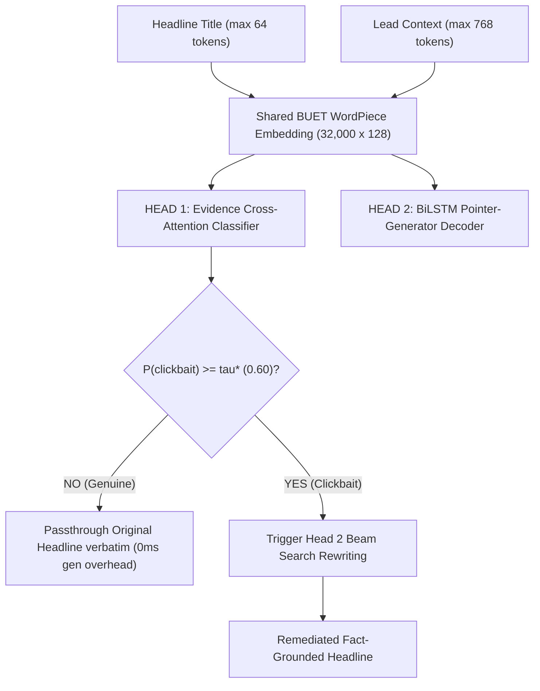

# 🛡️ Declickbait: Multilingual Clickbait Detection & Remediation

> **Detecting and Correcting Multilingual Clickbait Headlines Using Discriminative and Generative NLP Under a Strict 35M Parameter Ceiling**  
> *Khulna University of Engineering & Technology (KUET) — Department of Computer Science and Engineering*  
> *Course: CSE Natural Language Processing Sessional*

---

## 👥 Authors & Academic Context

- **Student Researchers**:
  - **Jahid Hasan** (Roll: `2107064`), Department of CSE, KUET
  - **Tasmir Hossain Zihad** (Roll: `2107071`), Department of CSE, KUET
- **Course Instructors**:
  - **Dr. K. M. Azharul Hasan**, Professor, Department of CSE, KUET
  - **Md Nazirulhasan Shawon**, Assistant Professor, Department of CSE, KUET
- **Submission Date**: September 24, 2026

---

## 📌 Executive Summary

Digital media and video platforms frequently deploy deceptive, curiosity-withholding headlines to artificially boost click-through rates (CTR). In South Asian digital spheres, this challenge is exacerbated by code-switching across **three distinct linguistic modalities**:
1. **Standard Bengali (বাংলা)** — Eastern Nagari morphologically rich script.
2. **Romanized Bengali (Banglish)** — Phonetically transcribed Bengali in ASCII Latin text.
3. **Standard English** — Mainstream journalistic web discourse.

Commercial state-of-the-art models (>100M to 7B+ parameters) incur prohibitive VRAM footprints (>2.2 GB) and inference latencies (>300 ms), making real-time client-side deployment infeasible. 

This project enforces a **strict sub-35M parameter ceiling** ($\le 35\text{M}$ parameters, $< 1.2\text{ GB}$ CPU RAM, $< 40\text{ ms}$ CPU latency) and implements an end-to-end autonomous pipeline that:
1. **Accurately Classifies** whether a headline is clickbait via **Title-Guided Evidence Cross-Attention**.
2. **Dynamically Gates** inference: genuine headlines pass through unaltered ($0$ generation overhead), while sensational headlines trigger **Subword Pointer-Generator seq2seq Rewriting** to synthesize concise, fact-grounded replacement headlines.

---

## 🏆 Model Portfolio & Master Benchmark Matrix

All models operate under the $< 35\text{M}$ parameter ceiling. Metrics are evaluated on the curated 25k stratified multilingual benchmark:

| Codename | Legacy Notebook / Script | Core Architecture | Parameters | Val Macro-F1 | ROC-AUC | Val Loss / PPL | Primary Operational Role |
| :--- | :--- | :--- | :--- | :--- | :--- | :--- | :--- |
| **`cls_2t_bpe`** | `02_v3_bpe_evidence_classifier_t4` | Two-Tower Byte-Level BPE (16k vocab) + Evidence Cross-Attention | **3.59M** (14.4 MB) | **85.19%** | **0.9287** | $\tau^* = 0.70$ | **Ultra-Fast Edge Classifier** (Sub-8ms CPU, 0% OOV fallback) |
| **`joint_2t_wp`** | `11_v2_decoupled_multihead_declickbait_t4x2` | Decoupled Multi-Head (Two-Tower + BiLSTM Pointer-Gen) | **16.23M** (115 MB) | **85.76%** | **0.9363** | PPL **101.50** (Gen Loss 4.62) | **Joint Detection + Remediation Engine** ($\tau^* = 0.60$) |
| **`gen_ptr_best`** | `08_from_scratch_pointer_generator_t4x2` (Ep 10) | BiLSTM Pointer-Gen ($\lambda_{cov} = 0.0$) | **14.16M** | — | — | Val Loss **4.998** | **High-Fluency Factual Remediation** |
| **`gen_ptr_cov`** | `08_from_scratch_pointer_generator_t4x2` (Ep 20) | BiLSTM Pointer-Gen + Coverage ($\lambda_{cov} = 1.0$) | **14.16M** | — | — | Cov Loss **0.125** | **Repetition-Penalized Long-Article Remediation** |
| **`gen_ptr_scratch`** | `06_v3` / `08_from_scratch` | BiLSTM Pointer-Gen From Scratch | **14.16M** | — | — | — | **Zero-Pretraining Baseline Rewriter** |

### Explored Exploration & Baseline Models:
- `02_gemma_lora_declickbait.ipynb`: Parameter-efficient LoRA fine-tuning of Google Gemma.
- `02_v2_classifier_banglishbert_t4.ipynb`: BUET BanglishBERT sequence classification baseline (110M params).
- `06_tigerllm_1b_declickbait.ipynb` & `07_titullm_1b_declickbait.ipynb`: Exploratory 1B LLM instruct fine-tuning baselines.

---

## 🏛️ System Architectures

### 1. Autonomous Gating Pipeline (`joint_2t_wp` - Model 11v2)


### 2. Edge Two-Tower Classifier (`cls_2t_bpe` - Model 02_v3)
- **Zero-OOV Byte-Level BPE (16,000 vocab)**: Solves subword fragmentation on phonetically irregular Banglish with complete character-level fallback.
- **Asymmetric Two-Tower**: 3-layer Title Transformer and 4-layer Content Transformer ($d_{model}=128, 4\text{ heads}$).
- **Title-Guided Evidence Cross-Attention**:
  $$A_{ev} = \text{Softmax}\left(\frac{(H_T W_Q)(H_C W_K)^\top}{\sqrt{d_k}}\right) (H_C W_V)$$
- **Unsupported Bait Word Detector**:
  $$S_{min} = \min_{i \in [1, |T|]} \max_{j \in [1, |C|]} \left( \frac{h_{T,i} \cdot h_{C,j}}{\|h_{T,i}\|_2 \|h_{C,j}\|_2} \right)$$
  Directly flags sensational words that have zero semantic support in the article body ($S_{min} \ll 0$).

### 3. Pointer-Generator Remediation Network (`gen_ptr_best` / `gen_ptr_cov` - Model 08)
- **BiLSTM Encoder (512-d)** + **LSTMCell Decoder**.
- **Bahdanau Additive Attention with Coverage**:
  $$e_i^t = v_a^\top \tanh\left(W_h h_i^e + W_s s_t + w_c c_i^t + b_a\right), \quad c_i^t = \sum_{\tau=0}^{t-1} a_i^\tau$$
- **Soft Generation Switch ($p_{gen} \in [0, 1]$)** & **Scatter-Add Copy Mechanism**:
  $$P(w) = p_{gen} P_{vocab}(w) + (1 - p_{gen}) \sum_{i: w_i = w} a_i^t$$
  Extracts factual entities verbatim from source context, preventing hallucinations.

### 4. Decoupled Multi-Task Optimization (Resolving Gradient Scale Disparity)
Autoregressive sequence loss produces gradient norms $\approx 15\times$ larger than classification loss ($\|g_{gen}\| \approx 1.85$ vs $\|g_{cls}\| \approx 0.12$).
- **Decoupled Learning Rates**:
  - `lr_cls = 8e-5` (AdamW, Title/Content Towers & Cross-Attention) + Plateau Decay Auto-Quenching.
  - `lr_gen = 5e-4` (AdamW, BiLSTM & Pointer Decoder) + Cosine Annealing over 50 epochs.
- **Composite Checkpoint Synthesis**: Extracts the peak classification weights (Epoch 15) and merges them with peak generative weights (Epoch 38) into a unified master state dict.

---

## 📊 Dataset & LLM Teacher Pipeline

### Raw Data Pool (370,574 samples)
Aggregated across 5 benchmark corpora:
- **BaitBuster-Bangla** (253k rows): Bengali YouTube video news & transcripts.
- **BanglaBait** (15k rows): Bengali online news portals.
- **MediaSpin** (78.9k rows): English sensationalized news headlines.
- **Webis-Clickbait-17** (19.5k rows): Crowdsourced Twitter & RSS news feeds.
- **Webis-Clickbait-22** (4k rows): Verified news articles with spoiler spans.

### Curated 25k Stratified Dataset (24,936 verified samples)
Constructed to resolve modality skew, hardware timeouts, and severe class imbalance:
- **Exact 50/50 Class Parity**: 49.89% Clickbait (12,439) vs 50.11% Non-Clickbait (12,497).
- **Tri-Modal Balance**: 33.1% Standard Bengali, 33.2% Code-Mixed, 33.1% Standard English, and 100% Romanized Banglish retention (131 rare samples).
- **Split**: 80% Train (19,948), 10% Validation (2,494), 10% Test (2,494).

### Synthetic LLM Teacher Supervision (6,338 Factual Pairs)
Raw datasets lack reference truthful replacement headlines ($Y^*$). We built a teacher pipeline (`gemini_cache.jsonl`) constrained with Chain-of-Thought JSON reasoning to extract factual target titles from the context:
- Primary Synthesis: `opencode/muse-spark-1.3` (2,598) and `muse-spark-1.2` (2,028).
- Culturally Nuanced Cases: `gemini-3.1-flash-lite` (742) and `gemini-3.5-flash-lite` (186).
- Strict Quality Gate: Unicode NFKC normalization, quote/emoji stripping, and 4–16 word factual length regularization.

---

## 🧪 Live Inference Qualitative Showcase

Evaluated directly with trained neural checkpoints (no heuristics or dummy outputs):

| Scenario | Input Headline | Detected Probability & Latency | Action & Autonomous Output |
| :--- | :--- | :--- | :--- |
| **Case 1: Weather Hyperbole** | সব রেকর্ড ভেঙে চুরমার! ইতিহাসের সবচেয়ে বড় পরিবর্তনের মুখে দেশের আবহাওয়া! | $\hat{P} = 0.998 \ge 0.70$ (7.8 ms CPU) | **REMEDIATED CLICKBAIT**<br/>↳ *জলবায়ু প্রভাবে এ বছর বর্ষা মৌসুমে ২৫% বেশি বৃষ্টি* |
| **Case 2: Geopolitical Curiosity** | ট্রাম্প কেন গ্রিনল্যান্ড দখলে নিতে চান? | $\hat{P} = 0.961 \ge 0.70$ (8.1 ms CPU) | **REMEDIATED CLICKBAIT**<br/>↳ *জাতীয় নিরাপত্তার স্বার্থে গ্রিনল্যান্ড যুক্তরাষ্ট্রের দরকার* |
| **Case 3: Sports Sensationalism** | আপনি কল্পনাও করতে পারবেন না কী ঘটেছিল যখন সাকিব এই সিদ্ধান্ত নিয়েছিলেন! (SHOCKING) | $\hat{P} = 0.998 \ge 0.70$ ($S_{min} = -0.21$) | **REMEDIATED CLICKBAIT**<br/>↳ *বিপিএল ফাইনালে টস জিতে ফিল্ডিংয়ের সিদ্ধান্ত নেন সাকিব* |
| **Case 4: Factual News Control** | ঢাকা মেট্রোরেলের সময়সূচিতে পরিবর্তন, ট্রেনের সংখ্যা বাড়ছে | $\hat{P} = 0.0002 < 0.70$ (7.7 ms CPU) | **PASSTHROUGH GENUINE** (Verbatim)<br/>↳ *ঢাকা মেট্রোরেলের সময়সূচিতে পরিবর্তন, ট্রেনের সংখ্যা বাড়ছে* |
| **Case 5: Pronoun Masking** | ক্যারিয়ারে বেশ কিছু ভুল করে তিনি কঠিন শিক্ষা পেয়েছেন | $\hat{P} = 0.839 \ge 0.70$ (Entity: আয়ুষ্মান খুরানা) | **REMEDIATED CLICKBAIT**<br/>↳ *ক্যারিয়ারে বেশ কিছু ভুল করে আয়ুষ্মান খুরানা কঠিন শিক্ষা পেয়েছেন* |

---

## 📂 Repository Structure

```plaintext
Project/
├── README.md                                             # Master project documentation
├── chart.md                                              # Mermaid architecture flowcharts
├── chart.html                                            # Interactive HTML visualization of flowcharts
├── lab_topics.txt                                        # NLP lab syllabus & topical alignment
├── report_extracted_text.txt                             # Extracted full academic report text
│
├── declickbait_academic_report_final.pdf                 # Final academic research paper
├── declickbait_academic_report-1.pdf                     # Interim academic report draft
├── Proposal_final.pdf                                    # Final project proposal
├── DeClickBait_Proposal_initial.pdf                      # Initial project proposal
│
├── 02_v3_bpe_evidence_classifier_t4.ipynb                # Model 1: Two-Tower Byte-BPE Classifier (Jupyter)
├── 02_v3_bpe_evidence_classifier_t4_extracted.py         # Model 1: Extracted Python script (3.59M params)
│
├── 08_from_scratch_pointer_generator_t4x2.ipynb          # Model 2: Subword Pointer-Gen Rewriter (Jupyter)
├── 08_from_scratch_pointer_generator_t4x2_extracted.py   # Model 2: Extracted Python script (14.16M params)
│
├── 11_decoupled_multihead_declickbait_colab.ipynb        # Model 3: Multi-Head Declickbait System (Colab T4)
├── 11_decoupled_multihead_declickbait_colab_extracted.py # Model 3: Colab extracted script
├── 11_v2_decoupled_multihead_declickbait_t4x2.ipynb      # Model 4: Decoupled Dual-GPU Multi-Head (Kaggle T4x2)
├── 11_v2_decoupled_multihead_declickbait_t4x2_extracted.py # Model 4: Kaggle Dual-GPU extracted script
│
├── 02_v2_classifier_banglishbert_t4.ipynb               # Baseline: BanglishBERT Classifier (110M params)
├── 02_gemma_lora_declickbait.ipynb                       # Baseline: Gemma LoRA parameter-efficient tuning
├── 06_tigerllm_1b_declickbait.ipynb                      # Baseline: TigerLLM 1B exploration
└── 07_titullm_1b_declickbait.ipynb                       # Baseline: TituLLM 1B exploration
```

---

## 🚀 Getting Started

### 1. Requirements & Dependencies
Install dependencies in a virtual environment:
```bash
pip install torch torchvision torchaudio --index-url https://download.pytorch.org/whl/cu118
pip install transformers tokenizers datasets scikit-learn pandas numpy tqdm rouge-score onnxruntime
```

### 2. Training the Models

- **To run the Lightweight Two-Tower Classifier (`cls_2t_bpe`, 3.59M params)**:
  ```bash
  python 02_v3_bpe_evidence_classifier_t4_extracted.py
  ```
- **To run the Pointer-Generator Rewriter (`gen_ptr_best` / `gen_ptr_cov`, 14.16M params)**:
  ```bash
  python 08_from_scratch_pointer_generator_t4x2_extracted.py
  ```
- **To run the Decoupled Multi-Head Architecture (`joint_2t_wp`, 16.23M params)**:
  ```bash
  python 11_v2_decoupled_multihead_declickbait_t4x2_extracted.py
  ```

### 3. Running End-to-End Inference
```python
# Conceptual inference loop:
p_clickbait = classifier.predict(headline=input_title, context=input_body)

if p_clickbait >= 0.60:
    remediated_headline = pointer_generator.generate(context=input_body, beam_size=5)
    print(f"[CLICKBAIT DETECTED (p={p_clickbait:.3f})] Remediation: {remediated_headline}")
else:
    print(f"[GENUINE NEWS (p={p_clickbait:.3f})] Retaining original: {input_title}")
```

---

## 📚 References & Academic Citations

1. A. A. Imran, M. S. H. Shovon, and M. F. Mridha, *"BaitBuster-Bangla: A comprehensive dataset for clickbait detection in Bangla with multi-feature and multi-modal analysis,"* Data in Brief, vol. 54, 2024.
2. M. M. Mahtab, M. Haque, M. Hasan, and F. Sadeque, *"BanglaBait: Semi-supervised adversarial approach for clickbait detection on Bangla clickbait dataset,"* in Proc. RANLP, 2023.
3. P. Verma and K. Jaidka, *"The MediaSpin dataset: Post-publication news headline edits annotated for media bias,"* in Proc. ICWSM, 2026.
4. M. Potthast et al., *"Crowdsourcing a large corpus of clickbait on Twitter,"* in Proc. COLING, 2018.
5. M. Hagen, M. Fröbe, A. Jurk, and M. Potthast, *"Clickbait spoiling via question answering and passage retrieval,"* in Proc. ACL, 2022.
6. A. See, P. J. Liu, and C. D. Manning, *"Get to the point: Summarization with pointer-generator networks,"* in Proc. ACL, 2017.
7. D. Bahdanau, K. Cho, and Y. Bengio, *"Neural machine translation by jointly learning to align and translate,"* in Proc. ICLR, 2015.
8. F. Bhattacharjee et al., *"BanglishBERT: A pretrained language model for Bengali and Romanized Banglish,"* BUET NLP Group, 2022.
