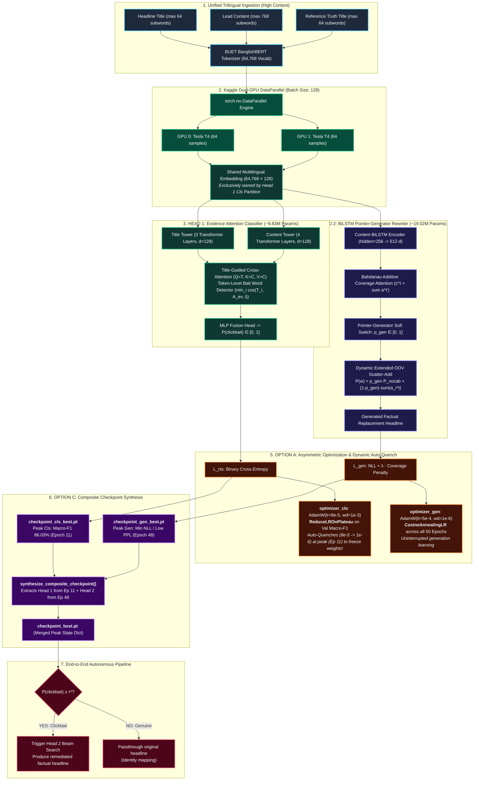
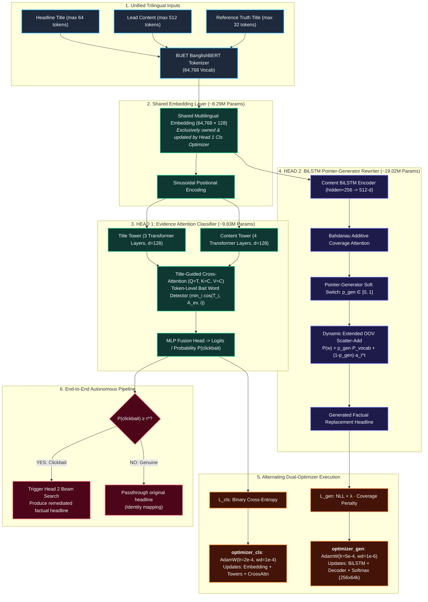
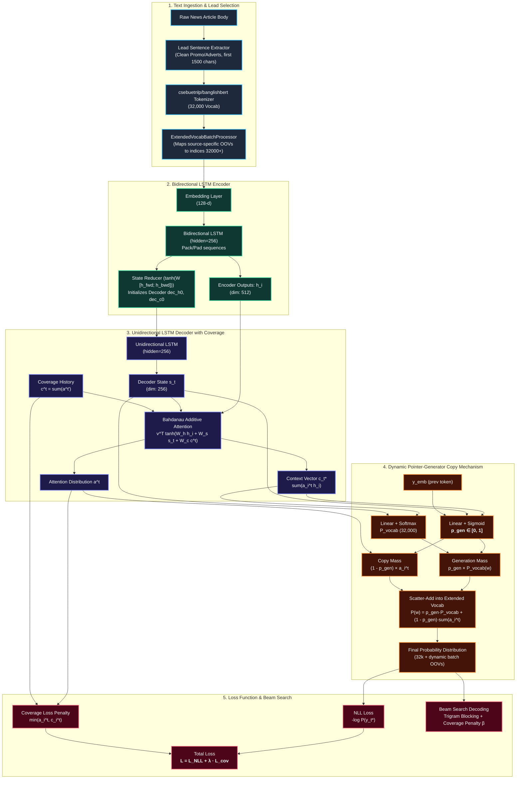
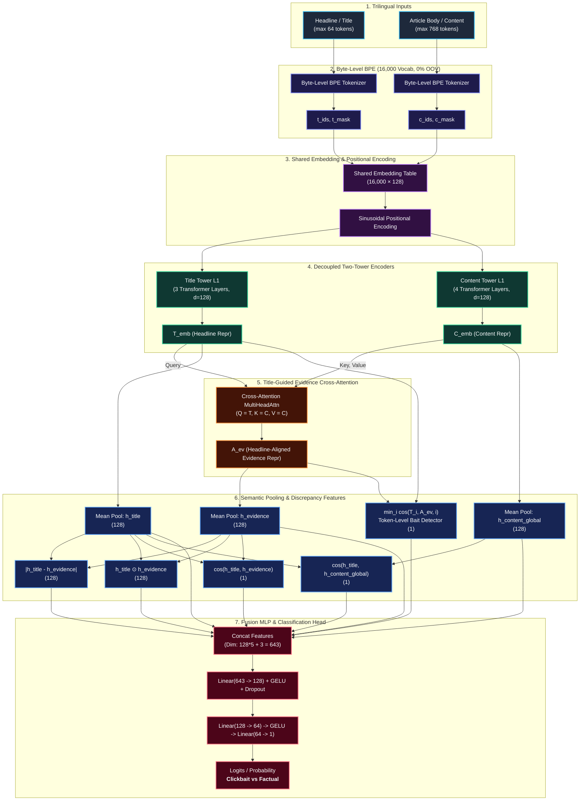

# 🏛️ Architecture Flowcharts (NLP Project)

---

## 🏆 Model 4 (11_v2): Dual-GPU Decoupled 2 × 8 Multi-Head System
**Hardware**: Kaggle Dual NVIDIA T4 (2x 16GB, DataParallel) | **Scale**: ~28.85M Parameters (~115 MB)  
**Innovations**: Option A (Auto-Quench Plateau Decay) + Option C (Composite Checkpoint Synthesis) | **Batch Size**: 128 (64/GPU)

---

## 🎯 Model 3 (11): Decoupled 2 × 8 Multi-Head Declickbait System
**Hardware**: Google Colab T4 / Dual T4 | **Scale**: ~28.85M Parameters (~115 MB) | **Strategy**: Option 1 Dual Independent Optimizers with Alternating Steps

---

## 🎯 Model 2 (06_v3): From-Scratch Pointer-Generator Headline Generator
**Hardware**: Google Colab T4 | **Vocab**: BUET BanglishBERT (32k) | **Paradigm**: Hybrid Seq2Seq with Dynamic OOV Copying & Coverage

---

## 🎯 Model 1 (02_v3): Title-Guided Evidence Attention Two-Tower Classifier
**Hardware**: Dual T4 / CPU Edge | **Vocab**: Byte-Level BPE (16k) | **Footprint**: ~3.59M Params (<15ms)

